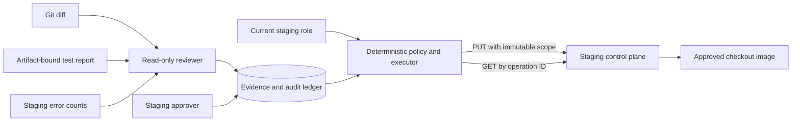

# Release Approval Agent

I built this to answer a question that comes up during release reviews. Which image did we actually approve?

An approver clears version 42 for staging. In the meantime, CI moves `staging-candidate` to version 43. The deployment service still starts version 42 because the approval covers the OCI digest, the checkout service, the staging environment, and the exact evidence reviewed.

The reviewer reads the Git diff, test report, and recent error rate. It records a recommendation with source references. An independent gate checks the evidence and the approver's current role before calling staging.

## Run the demo

Requires Python 3.12+ and Git. The live run also needs a local Docker daemon.

```bash
python -m approval_agent.demo --live
python -m unittest discover -s tests -v
python -m approval_agent.evaluate
```

Add `--interactive` to see the review and type its exact image reference before approval. Omit `--live` for a quick run with synthetic digests. Both runs create real Git commits and test the sample service at each candidate revision. The live run pushes both builds to a temporary loopback registry, moves the tag, starts the approved image by digest, and checks the container's `/version` response. The report includes the target's operation ID and the audit events.

| Scenario | Evidence in the report |
| --- | --- |
| Version 43 replaces the tag after approval | The new tag resolves to a different digest. The staged service still returns version 42. |
| The reviewer recommends a release with missing tests | The recommendation is retained. The gate records a block referencing the missing test report. |
| The reviewer loses the staging role after approval | The audit records the approval, role revocation, and execution block in sequence. |
| The target accepts the request and the response is lost | The operation enters `unknown`. A repeat checks the same operation ID and confirms deployment without starting another container. |

## How the release flows



A review snapshots the evidence. A human approval binds its hash to the image, service, and environment. At dispatch, the executor checks the current role, requires a passing test result for the exact commit and image, and rejects staging metrics older than 30 minutes or an error rate at or above 1%. It records a deterministic operation ID before the network call. The target accepts only the configured checkout image repository, staging, and the matching operation ID. Reconciliation looks up the same operation and can inspect the uniquely named container after a restart.

## Reviewer evaluation

The default reviewer is deterministic and runs without an API key. Both `review` and `approval_agent.evaluate` accept `--model-endpoint` and `--model` for a trusted OpenAI-compatible chat service. The review command takes a local Git repository and full commit IDs. It can load test and monitoring results from JSON. The model sees the evidence and can return only a recommendation with references to it. The executor evaluates its own policy.

The seven labeled evaluation cases measure decision accuracy, required source references, and unsafe recommendations separately. The baseline identifies all seven expected decisions and sources on this fixture. The live demo also injects an incorrect recommendation so the policy block can be observed independently of reviewer quality.

## Deployment boundary

The demo uses one service, a trusted local operator CLI, a mutable local role registry, and two SQLite databases. The monitoring samples are synthetic. The audit records decisions and their inputs and should be forwarded to an append-only store in a shared deployment.

The earliest integration point for a team is a staging promotion job. Use the CI system to attest which commit produced the image, replace the demo role registry with live environment authorization, and send the exact artifact to a deployment API that supports idempotency. An unresolved operation blocks further staging writes until it can be reconciled. The demo returns no automatic retry on an uncertain write.
