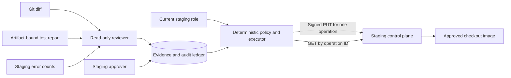

# Release Approval Agent

[](https://github.com/Cann65/release-approval-agent/actions/workflows/ci.yml)

I built this to answer a question that comes up during release reviews. Which image did we actually approve? An approver clears version 42 for staging. CI then moves `staging-candidate` to version 43. The deployment service still starts version 42 because the approval covers its OCI digest, the checkout service, the staging environment, and the evidence reviewed.

The reviewer reads the Git diff, test report, and recent error rate. It records a recommendation with source references. An independent gate checks the evidence and the approver's current role before calling staging.

## Run the demo

Requires Python 3.12+ and Git. The live run also needs a local Docker daemon.

```bash
python -m approval_agent.demo --live
python -m unittest discover -s tests -v
python -m approval_agent.evaluate
```

Add `--interactive` to see the review and type its exact image reference before approval. Omit `--live` for a quick run with synthetic digests. Both runs create real Git commits and test the sample service at each candidate revision. The live run pushes both builds to a temporary loopback registry, moves the tag, starts the approved image by digest, and checks the container's `/version` response. The report includes the target's operation ID and the audit events.

| Scenario | Evidence in the report |
| --- | --- |
| Version 43 replaces the tag after approval | The new tag resolves to a different digest. The staged service still returns version 42. |
| The reviewer recommends a release with missing tests | The recommendation is retained. The gate records a block referencing the missing test report. |
| The reviewer loses the staging role after approval | The audit records the approval, role revocation, and execution block in sequence. |
| The target accepts the request and the response is lost | The operation enters `unknown`. A repeat checks the same operation ID and confirms deployment without starting another container. |
| A caller uses only the status token to request a rollout | The staging API returns HTTP 403 before starting a container. |

GitHub Actions runs the Docker demo and publishes the audit report and reviewer evaluation together.

## How the release flows



A review snapshots the evidence. A human approval binds its hash to the image, service, and environment. At dispatch, the executor verifies that the stored evidence still matches the approved hash. It checks the approver's current role, requires a passing test result for the exact commit and image, and rejects staging metrics older than 30 minutes or an error rate at or above 1%.

The executor records a deterministic operation ID before the network call. The target verifies a 60-second HMAC authorization over that ID and the full release scope, then checks its staging and repository allowlist. `reconcile` uses the status token alone to look up an existing operation by ID and can confirm it after the signature has expired. For manual operation, configure `STAGING_TARGET_TOKEN` on the client and target. Give `STAGING_SIGNING_KEY`, a 32-byte random key encoded as 64 hex characters, only to the executor and target. The demo generates both secrets per run.

## Use an AWS ECR image

Use AWS CLI v2 with an existing AWS profile. `--ecr-tag` resolves a private ECR tag once, records the source tag in the evidence, and uses the resulting digest for review and approval. If CI supplies an immutable image reference directly, use `--artifact`.

```bash
python -m approval_agent review \
  --repo . --base "$BASE_SHA" --revision "$RELEASE_SHA" \
  --ecr-tag 123456789012.dkr.ecr.eu-central-1.amazonaws.com/team/checkout:staging-candidate \
  --aws-profile release-review \
  --tests test-report.json --monitoring staging-metrics.json
```

The test report must name the same commit and digest returned by ECR. If the tag has moved since CI generated the report, the gate blocks dispatch. The lookup calls `ecr:DescribeImages` and needs read access to the selected repository. [AWS CLI reference](https://docs.aws.amazon.com/cli/latest/reference/ecr/describe-images.html) · [ECR IAM actions](https://docs.aws.amazon.com/service-authorization/latest/reference/list_amazonelasticcontainerregistry.html)

```json
{
  "Version": "2012-10-17",
  "Statement": [{
    "Effect": "Allow",
    "Action": "ecr:DescribeImages",
    "Resource": "arn:aws:ecr:eu-central-1:123456789012:repository/team/checkout"
  }]
}
```

## Reviewer evaluation

The default reviewer is deterministic and runs without an API key. Both `review` and `approval_agent.evaluate` accept `--model-endpoint` and `--model` for a trusted OpenAI-compatible chat service. The review command takes a local Git repository and full commit IDs. It can load test and monitoring results from JSON. The model sees the evidence and can return only a recommendation with references to it. The executor evaluates its own policy.

The seven labeled evaluation cases measure decision accuracy, required source references, and unsafe recommendations separately. The baseline identifies all seven expected decisions and sources on this fixture. The live demo also injects an incorrect recommendation so the policy block can be observed independently of reviewer quality.

## Deployment boundary

The demo uses one service, a trusted local operator CLI, a local role registry, and two SQLite databases. The HMAC key is shared by the executor and target for this prototype. The monitoring samples are synthetic. The audit records decisions and their inputs and should be forwarded to an append-only store in a shared deployment.

The first integration point for a team is a staging promotion job. Use CI to attest which commit produced the image, use the team's identity provider for environment authorization, and connect the executor to a deployment API that supports idempotency. The ECR adapter covers image lookup. The deployment target runs a local Docker container. An unresolved operation blocks further staging writes, and reconciliation sends status queries for the original operation.
